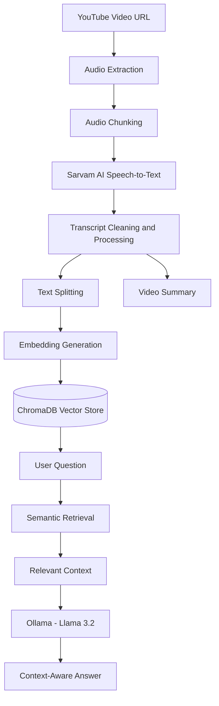

## 🎬 VidMind AI

An AI-powered video assistant that converts YouTube videos and audio into transcripts, generates summaries, and enables users to chat with video content.
Provide a YouTube video link and VidMind AI processes its audio, converts speech into text, builds a searchable knowledge base, and uses Retrieval-Augmented Generation (RAG) to answer questions grounded in the video's content.

**##🚀 Live Demo**
🌐 Streamlit App: Add your live Streamlit link here
The live application link will be added here once deployment is complete.


**✨ Features**
- YouTube video audio extraction
- Audio transcription using Sarvam AI
- English transcription using OpenAI Whisper
- Hindi and Hinglish transcription support
- Automatic audio chunking
- AI-powered summarization
- Local LLM integration using Ollama
- Video-based question answering (RAG)


**🧠 How It Works**

**Pipeline Explanation**
1. Input: The user provides a YouTube video URL.
2. Audio extraction: The application extracts the video's audio.
3. Transcription: Audio is divided into chunks and transcribed using Sarvam AI.
4. Text processing: The transcript is cleaned and split into smaller text chunks.
5. Indexing: Text chunks are converted into embeddings and stored in ChromaDB.
6. Retrieval: When a question is asked, relevant chunks are retrieved from the vector database.
7. Generation: The retrieved context is passed to Ollama running Llama 3.2.
8. Response: VidMind AI generates an answer based on the retrieved video content.

   
**🛠️ Tech Stack**
Technology	Purpose
- Python
- Streamlit
- Sarvam AI
- OpenAI Whisper
- Ollama
- Llama 3.2
- LangChain
- PyDub
- FFmpeg
- YouTube Transcript / Audio Processing
  

**💡 Example Use Cases**
- Summarize a long educational lecture.
- Ask questions about a programming tutorial.
- Find explanations of concepts discussed in a video.
- Review podcast or interview content.
- Search through a video's transcript using natural-language questions.
- Turn video content into a searchable learning resource.

**
🔐 Environment Variables**
Variable	Description
SARVAM_API_KEY	API key used for Sarvam AI transcription


## 📂 Project Structure

```text
video_assistant/
│
├── app.py
├── core/
│   └── transcriber.py
├── utils/
├── downloads/
├── requirements.txt
├── .env.example
├── .gitignore
└── README.md
```


